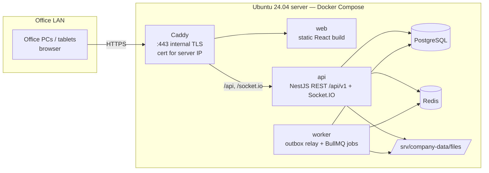

# 00 — Architecture proposal

## 1. Shape of the system

A **modular monolith**: one NestJS API process plus one worker process built
from the same codebase, one React single-page app, PostgreSQL as the only
source of truth, Redis for queues/cache/realtime fan-out, Caddy in front. All
of it runs with Docker Compose on one Ubuntu Server 24.04 machine on the office
LAN, with no runtime dependency on the internet.



Only Caddy publishes a port (443, plus 80 redirect). PostgreSQL and Redis sit
on an internal Docker network with no published ports.

### Why these choices

| Concern | Decision | Reason |
|---|---|---|
| Backend | NestJS + TypeScript on Node.js LTS | Required by spec; modules map cleanly to business domains |
| ORM / migrations | Prisma (ADR 0002) | Typed queries, reviewed SQL migration files, interactive transactions for the outbox |
| Frontend | React + TypeScript + Vite, React Router, TanStack Query, Mantine UI | Desktop-first, tablet-usable; Mantine ships its own CSS and works fully offline |
| Validation | Zod schemas in a shared package, used by API DTOs and forms | One definition of each payload |
| Auth | Server-side sessions in PostgreSQL, HttpOnly + Secure + SameSite=Strict cookie, CSRF token header, Argon2id (ADR 0003) | Easy revocation, no tokens in browser storage |
| Realtime | Socket.IO with Redis adapter; clients re-fetch from REST on reconnect | Postgres stays authoritative; app still works if Redis/socket drops |
| Events | Transactional outbox table → worker → BullMQ consumers with idempotency keys (ADR 0004) | Required by spec; no lost or duplicated side effects |
| HTTPS | Users open `https://<server LAN IP>`. Caddy `tls internal` issues a certificate for that IP; its root cert is installed once on each office PC (ADR 0005) | **Browsers only allow microphone access on HTTPS** — voice notes need it. No DNS needed |
| Files | Local filesystem, random storage keys, metadata in Postgres, streamed through permission-checked endpoints | Spec section 12 |
| Backups | `pg_dump` (custom format) daily + Restic for files and dumps, weekly copy to external disk | Spec section 20 |

## 2. Backend module breakdown (`apps/api`)

Each module owns its tables, services and controllers. Other modules call its
**service interface**, never its tables directly.

| Module | Responsibility |
|---|---|
| `core/config`, `core/db`, `core/logging`, `core/health` | Env config validation, Prisma client, structured JSON logs (pino, secrets redacted), `/health` and `/ready` |
| `auth` | Login/logout, sessions, rotation, rate limiting, CSRF, change password, admin reset, account lock |
| `access` | Users, departments, roles, permissions, user↔department, role↔department scopes; the `AccessPolicy` service every other module uses (`can(user, permission, resource)`) |
| `audit` | Append-only audit log writer used inside business transactions |
| `outbox` | Writes events inside transactions; worker relays them to BullMQ; retries, dead letter, admin view |
| `jobs` | Service types, Job Number sequences, jobs, job briefs, job members, optional customers |
| `workflow-templates` | Templates, versions (draft → published, immutable once published), stages, transitions, template tasks, checklists, stage permissions |
| `workflow-engine` | Instantiates a version for a job; activates/completes/holds/returns/reopens stages; evaluates gates; creates rework occurrences. **The only code allowed to change stage status.** |
| `tasks` | Tasks, assignments, dependencies, checklist items, comments, time entries, deadlines |
| `design` | Artwork versions, correction rounds, customer approval records |
| `authority` (PRO) | Authority types, applications, submissions, documents, status history, payments, Not-Required exceptions |
| `logistics` | Vehicle schedules and history, delivery records and evidence |
| `production` | Machines, production orders/items/logs (both service types) |
| `installation` | Installation orders, assignments, materials, logs (wrap and signage) |
| `quality` | QC checklist templates, inspections, results, pass/fail → engine |
| `discussions` | Channels, members, messages (threaded), attachments, mentions, reactions, pins, read receipts, edits, search |
| `corrections` | Correction items and status history; can block stage completion |
| `files` | Upload (incl. chunked), type sniffing, checksum, versions, download/preview, access logs |
| `notifications` | In-app notifications and preferences; consumer of events only |
| `realtime` | Socket.IO gateway, room auth (per user, per channel, per job) |
| `reports` | Dashboards and metrics queries, CSV/XLSX export |
| `admin` | System settings, upload limits, maintenance mode, dead-letter dashboard |

Workflow-specific stage logic (e.g. "Government Approval is satisfied when every
required authority application is Approved or Not Required") is implemented as
**gate evaluators** registered by key (`design.customer_approval_recorded`,
`authority.all_required_approved`, `logistics.schedule_confirmed`,
`quality.inspection_passed`, `logistics.delivery_completed`, …). Templates
reference gate keys; the engine calls them. Sequences are never hardcoded.

## 3. Frontend module breakdown (`apps/web`)

| Area | Screens |
|---|---|
| Shell | Login, change password, top bar (search by Job Number, notifications bell, unread badge), role-aware navigation |
| Dashboards | Management, Sales, Department Leader, Design, PRO, Logistic, Production, Installation, Quality, Admin |
| Jobs | Job list (filters, pagination), create job + brief (per service type form), job detail with tabs: Overview, Workflow (timeline), Tasks, Files, Design/Approvals, Discussions, Corrections, Production/Installation, QC, Delivery (VB only), Activity |
| Tasks | My tasks, department board, assignment dialog |
| Discussions | Channel view, threads, attachments, voice recorder (record/pause/resume/stop/preview/re-record/upload progress), mentions, reactions, pins, search |
| Admin | Users, departments, roles and permissions, workflow template editor (draft/publish), QC checklist templates, authority types, numbering rules, settings, audit log, outbox dead letters, backup status |

The frontend has no business rules beyond hiding actions the API reports as
not allowed (each resource response includes an `allowedActions` list
computed by the backend).

## 4. Repository structure

```
bayan-jobflow/
├── apps/
│   ├── api/                 NestJS API + worker entrypoint (src/main.ts, src/worker.ts)
│   │   ├── prisma/          schema.prisma, migrations/, seed/
│   │   └── src/modules/…    one folder per module above
│   └── web/                 React + Vite app
├── packages/
│   └── shared/              Zod schemas, permission keys, event names, enums
├── deploy/
│   ├── docker-compose.yml
│   ├── Caddyfile
│   ├── .env.example
│   ├── scripts/             install.sh, backup.sh, restore.sh, migrate.sh, seed-admin.sh, update.sh, rollback.sh
│   └── systemd/             backup timers
├── docs/                    design docs, ADRs, guides (install, LAN/DNS/HTTPS, admin, user, maintenance)
├── CHANGELOG.md
└── package.json             npm workspaces
```

## 5. Deployment plan (Ubuntu Server 24.04, LAN)

| Path | Contents |
|---|---|
| `/srv/bayan-jobflow/` | Git checkout, `deploy/docker-compose.yml`, `.env` (mode 600), scripts |
| `/srv/company-data/postgres/` | PostgreSQL data (bind mount, owned by container uid) |
| `/srv/company-data/redis/` | Redis AOF |
| `/srv/company-data/files/` | Uploaded files (random keys, sharded dirs) |
| `/srv/company-data/backups/` | pg_dump files + Restic repository staging |
| `/srv/company-data/imports/`, `/exports/` | Controlled import/export |

Install steps (to be scripted in Phase 7, tested in Phase 1 on a VM):

1. Install Docker Engine + Compose plugin from Docker's apt repo (needs internet once).
2. Create `/srv/company-data/*` with documented ownership; copy `.env.example` → `.env`, generate secrets.
3. `docker compose build` (or load pre-built images with `docker load` for offline installs).
4. `docker compose up -d`; `migrate.sh`; `seed-admin.sh` creates the first System Administrator interactively.
5. Give the server a **static LAN IP** (or a DHCP reservation on the router), set it as `JOBFLOW_HOST` in `.env`. Caddy issues an internal certificate for that IP; export the Caddy root CA and install it on each PC (guide for Windows/macOS/Android tablets).
6. Users bookmark `https://<server IP>`. If an internal DNS name is added later, it is appended to `JOBFLOW_HOST` and Caddy covers both.
7. Firewall: UFW allows 22 from admin IPs and 443/80 from LAN subnet. Because Docker-published ports bypass UFW's INPUT chain, Caddy binds to the server's LAN IP only and rules are added to the `DOCKER-USER` chain; verified from a second LAN machine with `nmap`.
8. All services use `restart: unless-stopped` and health checks; Docker starts on boot.
9. Backups via systemd timers: daily `pg_dump`, nightly Restic of files + dumps, weekly copy to external disk; monthly restore test into a scratch Compose project.
