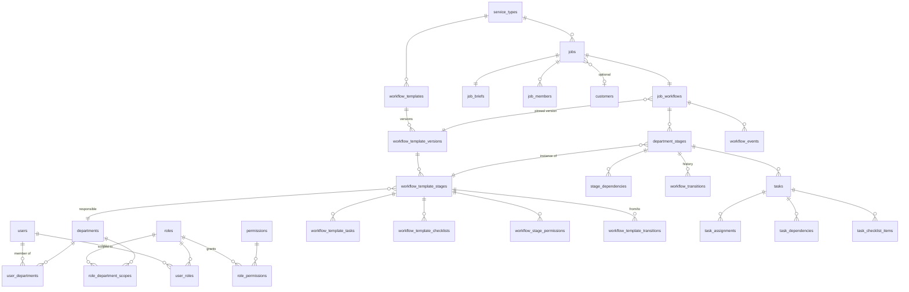

# 01 — Initial database ERD

Conventions: PostgreSQL, UUID v7 primary keys (time-ordered, good index
locality), `created_at`/`updated_at` `timestamptz` everywhere, `deleted_at` only
where soft delete is a business need (users, messages, files, tasks). Enums are
Postgres enums or lookup tables where admins must edit them. Audit, approval,
status-history and workflow-event tables are **append-only** and use
`ON DELETE RESTRICT` foreign keys — nothing cascades into history.

## Core: identity, jobs, workflow

## Domain modules (all hang off `jobs` and usually a `department_stages` row)

```mermaid
erDiagram
  jobs ||--o{ artwork_versions : ""
  artwork_versions }o--|| files : "immutable file"
  jobs ||--o{ correction_rounds : ""
  correction_rounds ||--o{ artwork_versions : "produces"
  artwork_versions ||--o{ approval_records : "approved as"

  jobs ||--o{ authority_applications : ""
  authority_types ||--o{ authority_applications : ""
  authority_applications ||--o{ authority_submissions : ""
  authority_applications ||--o{ authority_status_history : ""
  authority_applications ||--o{ authority_payments : ""
  authority_submissions ||--o{ authority_documents : ""

  jobs ||--o{ vehicle_schedules : ""
  vehicle_schedules ||--o{ vehicle_schedule_history : ""
  jobs ||--o{ production_orders : ""
  production_orders ||--o{ production_items : ""
  production_orders ||--o{ production_logs : ""
  machines ||--o{ machine_assignments : ""
  jobs ||--o{ installation_orders : ""
  installation_orders ||--o{ installation_assignments : ""
  installation_orders ||--o{ installation_logs : ""
  qc_checklist_templates ||--o{ qc_inspections : ""
  jobs ||--o{ qc_inspections : ""
  qc_inspections ||--o{ qc_checklist_results : ""
  jobs ||--o{ delivery_records : ""
  delivery_records ||--o{ delivery_evidence : ""
  jobs ||--o| job_closures : ""

  jobs ||--o{ discussion_channels : ""
  discussion_channels }o--o| departments : "null = General"
  discussion_channels ||--o{ discussion_channel_members : ""
  discussion_channels ||--o{ discussion_messages : ""
  discussion_messages ||--o{ discussion_messages : "parent_message_id"
  discussion_messages ||--o{ discussion_attachments : ""
  discussion_attachments }o--|| files : ""
  discussion_messages ||--o{ discussion_message_edits : ""
  discussion_messages ||--o{ discussion_mentions : ""
  discussion_messages ||--o{ discussion_reactions : ""
  discussion_messages ||--o{ discussion_read_receipts : ""
  discussion_messages ||--o{ discussion_pins : ""

  jobs ||--o{ correction_items : ""
  correction_items }o--o| discussion_messages : "source"
  correction_items }o--o| department_stages : "blocks"
  correction_items ||--o{ correction_status_history : ""

  files ||--o{ file_versions : ""
  files ||--o{ job_files : ""
  files ||--o{ file_access_logs : ""
```

System tables: `notifications`, `notification_preferences`,
`workflow_outbox_events`, `automation_rules`, `automation_runs`, `audit_logs`,
`system_settings`, `sessions`, `job_number_sequences`, `upload_sessions`.

## Key relationships and rules

- **Template versioning.** `workflow_template_versions` has `status`
  (`draft|published|retired`) and `version_no`; a published version is
  immutable (enforced in service + DB trigger). `job_workflows.template_version_id`
  pins the exact version, so editing a template never changes active jobs.
- **Stage occurrences.** `department_stages(job_workflow_id, template_stage_id,
  occurrence_no)` is unique. Rework creates `occurrence_no + 1`; earlier
  occurrences keep their status, tasks, files and comments. Status:
  `pending | active | on_hold | completed | returned | skipped | cancelled`.
- **Transitions.** Every status change writes a `workflow_transitions` row
  (from, to, actor, reason) and a `workflow_outbox_events` row in the same
  transaction.
- **Job Number.** `jobs.job_number` unique; generated from
  `job_number_sequences(service_type_id, year)` with `SELECT … FOR UPDATE`, so
  numbers are gap-free per year and never duplicated.
- **Brief.** `job_briefs` has typed columns common to both services plus a
  `service_details jsonb` validated against a per-service Zod schema (vehicle
  details vs. site/dimensions). Customer data lives only in optional
  `customers`/`jobs.customer_id`; the Vehicle Branding brief neither requires
  nor displays it.
- **Approvals.** `approval_records.artwork_version_id` is NOT NULL; a new
  artwork version has no approval until one is recorded manually.
- **Authority gate.** One `authority_applications` row per required authority
  per job; `status` with full `authority_status_history`. Not-Required needs
  `not_required_reason` + actor and writes an audit entry.
- **Channels.** Unique `(job_id, department_id)`; unique `(job_id)` where
  `department_id IS NULL AND type='general'`. Rework reuses the channel.
  Messages carry nullable `stage_id`.
- **Uniqueness.** `role_permissions(role_id, permission_id)`,
  `discussion_channel_members(channel_id, user_id)`,
  `discussion_read_receipts(message_id, user_id)`,
  `discussion_pins(channel_id, message_id)`,
  `discussion_reactions(message_id, user_id, emoji)`,
  `workflow_outbox_events(idempotency_key)`,
  `notifications(user_id, event_id)`.
- **Indexes.** `jobs(job_number)`, `jobs(status, service_type_id)`,
  `department_stages(status, department_id)`, `task_assignments(user_id)`,
  `tasks(due_at)`, `discussion_messages(channel_id, created_at)`,
  `job_files(job_id)`, full-text GIN on `discussion_messages.body`.
- **Retention.** Users are disabled, never deleted. Files and messages are
  soft-deleted. Audit, approval, authority, QC and workflow history are never
  deleted by the application.
