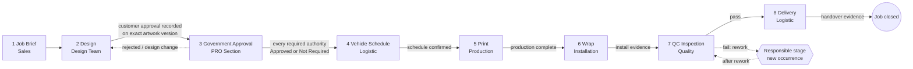
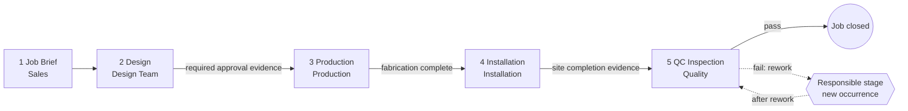

# 02 — Workflows

Both workflows are **seed data for versioned templates** (v1), not code. An
administrator can edit department names, permissions, checklists and gates by
publishing a new version; active jobs keep the version they started with.

## Vehicle Branding (template `VB`, v1)

| # | Stage | Department | Completion gate (all must hold) |
|---|---|---|---|
| 1 | Job Brief | Sales | Job Number assigned; required brief fields filled (no customer fields) |
| 2 | Design | Design | ≥1 artwork version; an approval record exists for the **latest** version; no open blocking corrections |
| 3 | Government Approval | PRO | Each required authority application is `Approved` or `Not Required` (reason + admin/leader + audit) |
| 4 | Vehicle Schedule | Logistic | Schedule status `Confirmed` with recorded vehicle availability |
| 5 | Print | Production | All production items complete; approved artwork version referenced |
| 6 | Wrap | Installation | Installation complete, technicians and completion photos recorded |
| 7 | QC Inspection | Quality | Latest inspection `Passed` |
| 8 | Delivery | Logistic | Delivery record `Completed` with recipient and evidence → job closes |

Rules enforced by the engine:
- PRO permissions are not required to enter or work in Design.
- Print and Wrap cannot activate while Government Approval is incomplete
  (follows from sequence; also checked as an explicit gate so a future template
  re-ordering cannot bypass it).
- PRO "return to Design" requires a reason, keeps the rejection, the
  submission and all earlier artwork, and creates Design occurrence n+1. A new
  artwork version then needs a new customer approval, and PRO resubmits in
  Government Approval occurrence n+1.
- QC fail → inspector records defects and selects the responsible stage
  (Print, Wrap, or Design); a correction item is created and assigned to that
  department; that stage reopens as a new occurrence; re-inspection is a new
  `qc_inspections` row; Delivery stays locked until a pass.
- The job closes only when Delivery completes.

## Signage (template `SG`, v1)

| # | Stage | Department | Completion gate |
|---|---|---|---|
| 1 | Job Brief | Sales | Scope, drawings, dimensions, specifications, site details, attachments as configured |
| 2 | Design | Design | Artwork/technical drawings; approval record on latest version (configurable as required) |
| 3 | Production | Production | Production tasks and completion evidence |
| 4 | Installation | Installation | Schedule, technicians, site completion evidence |
| 5 | QC Inspection | Quality | Latest inspection `Passed` → **job closes immediately** |

- No Logistic stage, no Delivery stage, no PRO stage. No Logistic channel
  unless an admin explicitly adds one to a job for collaboration.

## Engine behaviour (both)

- Stages are sequential; tasks inside a stage may run in parallel or have
  dependencies.
- A stage completes only through `POST /jobs/:id/stages/:stageId/complete`,
  which runs all gate evaluators, required tasks, checklist items, required
  files and blocking corrections inside one transaction.
- Leaders can **hold**, **return for correction**, **reopen** or record an
  **exception** — each needs a reason and is audited.
- Completing a stage writes `workflow.stage.completed` and activates the next
  stage (`workflow.stage.activated`) in the same transaction; event handlers are
  idempotent (unique idempotency keys), so a retried event never creates
  duplicate stages, tasks or notifications.

## Rework scope (default, needs confirmation — see open question Q3)

When a stage is reopened by a return or QC fail, the engine re-runs **from the
target stage forward** up to the stage that returned it. The leader of each
intermediate stage may mark its new occurrence `skipped – not affected` with a
reason (e.g. a Wrap fix after QC fail does not require a new Print).
